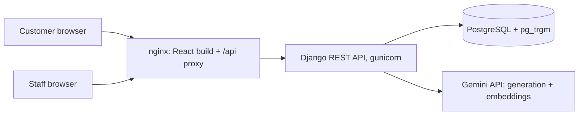

# Hecate

[](https://github.com/MatheusDSantossi/hecate-chatbot/actions/workflows/ci.yml)
[](LICENSE)

**Multi-tenant AI chatbot for retail product catalogs.** Each store gets its own chat page where customers ask, in Portuguese, about products, prices, stock and aisle sections, and an admin dashboard to manage the catalog the bot answers from.

Built as my undergraduate thesis (TCC) at the Universidade Federal Rural de Pernambuco (UFRPE). The marketing site lives in [hecate-landing-page](https://github.com/MatheusDSantossi/hecate-landing-page).

[Leia em português](README.pt-BR.md)

---

## What it does

**For a store's customers** (`/chatbot/<store-slug>`, no account needed)
- Ask free-form questions ("vocês têm refrigerante?", "o que tem na seção 3?") or pick from menu options
- Answers are grounded in the store's own catalog: product name, brand, price, stock and section

**For store staff** (`/admin`, login required)
- Product catalog: create, edit and delete products, or import a CSV/XLSX file
- Business details the bot can use in answers (opening hours, promotions, and so on)
- Dashboard charts and tables over the catalog
- Team access by invite link; sign-in with email and password or Google; password reset by email

---

## Architecture



- **Frontend**: React + TypeScript single-page app, served by nginx, which also proxies `/api/` to the backend
- **Backend**: Django + Django REST Framework, organized in three apps: `chatbot` (products, chat, menu options, business details), `users` (accounts, invites, auth) and `core` (businesses)
- **Database**: PostgreSQL. The `pg_trgm` extension powers fuzzy name matching; product embeddings are stored as JSON on each product row

---

## How a question gets answered

Retrieval follows a two-stage pattern: a cheap, fuzzy search narrows the catalog, then a semantic score ranks what is left.

1. **Understand the message.** Depending on the question type (general, brand or section), Gemini rewrites the message into a clean product query (spelling, abbreviations, Portuguese product naming). spaCy (`pt_core_news_sm`) and regular expressions extract product phrases, sections, prices and quantities.
2. **Candidate generation in Postgres.** `pg_trgm` trigram similarity finds products whose names are close to the query, which tolerates typos like "refrigerante" vs "refri".
3. **Semantic reranking.** The query is embedded with Gemini `text-embedding-004` and compared by cosine similarity against the stored embeddings of the candidates only, in one vectorized NumPy call.
4. **Fallback.** If nothing is extracted, a TF-IDF match over normalized product names (scikit-learn) picks the closest products.
5. **Grounded answer.** Gemini 2.0 Flash writes the reply from the matched rows (name, brand, price, stock, section) and the store's business details.

Product embeddings are computed once, when a product is created or imported, not per question.

---

## Multi-tenancy and auth

- Every product, menu option and business detail belongs to a `Business`; staff users belong to one business, and staff endpoints filter by it (another store's product returns 404)
- Token authentication with [django-rest-knox](https://github.com/jazzband/django-rest-knox), Google sign-in with django-allauth, password reset with django-rest-passwordreset, and invite-based registration
- API permissions fail closed: `IsAuthenticated` is the default, and public endpoints (chat, store list, login, registration) opt in with `AllowAny`
- All secrets come from environment variables; the Django secret key has no fallback, so a missing key stops startup

---

## Tech stack

| Area | Tools (versions from `requirements.txt` / `package.json`) |
|---|---|
| API | Django 5.2.8, Django REST Framework 3.15.2, gunicorn 23, WhiteNoise 6.11 |
| Auth | django-rest-knox 5.0.2, django-allauth 65.4.1, django-rest-passwordreset 1.5.0 |
| AI | Gemini 2.0 Flash and `text-embedding-004` via `google-generativeai` 0.8.3 |
| NLP / search | PostgreSQL `pg_trgm`, spaCy 3.8.7 (`pt_core_news_sm`), scikit-learn 1.6.0, pandas 2.2.3 |
| Database | PostgreSQL 18 (Docker image) |
| Frontend | React 18.2, TypeScript 5.9, Vite 6, MUI 6 + MUI X Charts 7, Tailwind CSS 4, React Three Fiber 8 |
| Infra | Docker Compose (backend, frontend/nginx, Postgres), GitHub Actions CI |

---

## Running locally

Requires Docker with Compose.

```bash
git clone https://github.com/MatheusDSantossi/hecate-chatbot.git
cd hecate-chatbot
cp .env.example .env
```

Edit `.env`. To run the stack locally you need at least:

| Variable | Value |
|---|---|
| `DJANGO_SECRET_KEY` | any long random string |
| `DATABASE_PASSWORD` | any password (used to create the local database) |
| `GEMINI_API_KEY` | a [Gemini API key](https://aistudio.google.com/apikey); needed for chat answers and product embeddings |
| `GOOGLE_OAUTH_CLIENT_ID` | required at startup; any placeholder works if you skip Google sign-in |

```bash
docker compose up --build
```

- App: http://localhost
- API: http://localhost:8000/api/

The backend container applies migrations and collects static files on start.

### Create a store and load products

```bash
# Create a business (store) and a staff user
docker compose exec backend python manage.py shell -c "
from core.models import Business
from users.models import CustomUser
biz = Business.objects.create(name='My Store', slug='my-store')
CustomUser.objects.create_user(email='admin@example.com', password='change-me', business=biz)
"

# Import a product spreadsheet; creates embeddings, so GEMINI_API_KEY must be valid
docker compose exec backend python manage.py import_big_super path/to/products.xlsx --business my-store
```

Then open http://localhost/chatbot/my-store. Products can also be added from the admin dashboard (manual form or CSV/XLSX upload).

---

## Engineering practices

- **CI** on every pull request (`.github/workflows/ci.yml`): frontend lint and production build; backend migrations replayed on an empty PostgreSQL, `manage.py check`, and a check for missing migrations
- **Migrations are replayable**: a fresh database migrates from zero, which CI enforces
- **Conventional commits**, feature branches, and pull requests into a protected `main`

---

## Known limitations

Honest list, tracked in the issues:

- **Tests**: automated tests are stubs today; CI checks build, migrations and configuration, not behavior
- **Tenant isolation in the chat flow** is incomplete: some chat-side queries and a per-process cache ignore the business ([#17](https://github.com/MatheusDSantossi/hecate-chatbot/issues/17))
- **The chat endpoint is public and not rate-limited**, so heavy use spends Gemini quota; a message can trigger several Gemini calls
- **Embeddings are stored as JSON** and scored in Python. Fine for one store's catalog; the scaling path is [pgvector](https://github.com/pgvector/pgvector) with an approximate-nearest-neighbour index
- **Portuguese only**: prompts and the spaCy model are Brazilian Portuguese
- Celery and Redis are listed in `requirements.txt` for planned background jobs but are not used yet

---

## Project structure

```
hecate-chatbot/
├── backend/
│   ├── chatbot/          # products, chat endpoint, menu options, business details, management commands
│   ├── users/            # custom user, invites, auth endpoints
│   ├── core/             # Business model, tenant scoping mixin
│   ├── utils/            # retrieval pipeline: prompts, trigram and embedding search, loaders
│   └── chatbot_project/  # settings and URLs
├── frontend/
│   ├── src/components/   # chat UI, admin dashboard, product registration, forms
│   └── nginx/            # nginx config template (API upstream from API_UPSTREAM)
├── docker-compose.yml
└── .env.example
```

---

## License

Distributed under the MIT License. See [LICENSE](LICENSE).
