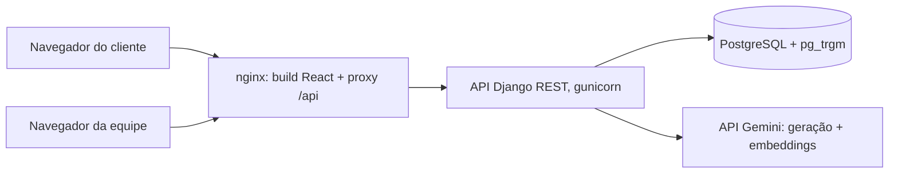

# Hecate

[](https://github.com/MatheusDSantossi/hecate-chatbot/actions/workflows/ci.yml)
[](LICENSE)

**Chatbot com IA multi-tenant para catálogos de varejo.** Cada loja tem sua própria página de chat, onde os clientes perguntam sobre produtos, preços, estoque e seções, e um painel administrativo para gerenciar o catálogo que o bot usa nas respostas.

Desenvolvido como meu Trabalho de Conclusão de Curso (TCC) na Universidade Federal Rural de Pernambuco (UFRPE). O site de apresentação está em [hecate-landing-page](https://github.com/MatheusDSantossi/hecate-landing-page).

[Read in English](README.md)

---

## O que faz

**Para os clientes da loja** (`/chatbot/<slug-da-loja>`, sem conta)
- Perguntas livres ("vocês têm refrigerante?", "o que tem na seção 3?") ou opções de menu
- As respostas se baseiam no catálogo da própria loja: nome, marca, preço, estoque e seção do produto

**Para a equipe da loja** (`/admin`, com login)
- Catálogo de produtos: criar, editar e excluir produtos, ou importar um arquivo CSV/XLSX
- Informações do negócio que o bot pode usar nas respostas (horário de funcionamento, promoções etc.)
- Gráficos e tabelas sobre o catálogo
- Acesso da equipe por link de convite; login com e-mail e senha ou Google; redefinição de senha por e-mail

---

## Arquitetura



- **Frontend**: aplicação React + TypeScript servida pelo nginx, que também encaminha `/api/` para o backend
- **Backend**: Django + Django REST Framework, em três apps: `chatbot` (produtos, chat, opções de menu, informações do negócio), `users` (contas, convites, autenticação) e `core` (negócios)
- **Banco de dados**: PostgreSQL. A extensão `pg_trgm` faz a busca aproximada por nome; os embeddings dos produtos ficam em JSON em cada linha de produto

---

## Como uma pergunta é respondida

A busca segue um padrão em duas etapas: uma busca aproximada e barata reduz o catálogo, e uma pontuação semântica ordena o que sobrou.

1. **Entender a mensagem.** Conforme o tipo de pergunta (geral, marca ou seção), o Gemini reescreve a mensagem como uma consulta de produto limpa (ortografia, abreviações, nomes de produtos em português). spaCy (`pt_core_news_sm`) e expressões regulares extraem produtos, seções, preços e quantidades.
2. **Geração de candidatos no Postgres.** A similaridade por trigramas do `pg_trgm` encontra produtos com nomes parecidos com a consulta, tolerando erros de digitação.
3. **Reordenação semântica.** A consulta vira um embedding com o Gemini `text-embedding-004` e é comparada por similaridade de cosseno apenas com os candidatos, em uma única chamada vetorizada do NumPy.
4. **Alternativa.** Se nada for extraído, uma comparação TF-IDF sobre os nomes normalizados (scikit-learn) escolhe os produtos mais próximos.
5. **Resposta fundamentada.** O Gemini 2.0 Flash escreve a resposta a partir dos produtos encontrados (nome, marca, preço, estoque, seção) e das informações da loja.

Os embeddings dos produtos são calculados uma vez, quando o produto é criado ou importado, e não a cada pergunta.

---

## Multi-tenancy e autenticação

- Todo produto, opção de menu e informação do negócio pertence a um `Business`; cada usuário da equipe pertence a um negócio, e os endpoints da equipe filtram por ele (o produto de outra loja retorna 404)
- Autenticação por token com [django-rest-knox](https://github.com/jazzband/django-rest-knox), login com Google via django-allauth, redefinição de senha com django-rest-passwordreset e cadastro por convite
- As permissões da API falham fechadas: `IsAuthenticated` é o padrão, e os endpoints públicos (chat, lista de lojas, login, cadastro) usam `AllowAny` explicitamente
- Todos os segredos vêm de variáveis de ambiente; a chave secreta do Django não tem valor padrão, então a aplicação não inicia sem ela

---

## Tecnologias

| Área | Ferramentas (versões de `requirements.txt` / `package.json`) |
|---|---|
| API | Django 5.2.8, Django REST Framework 3.15.2, gunicorn 23, WhiteNoise 6.11 |
| Autenticação | django-rest-knox 5.0.2, django-allauth 65.4.1, django-rest-passwordreset 1.5.0 |
| IA | Gemini 2.0 Flash e `text-embedding-004` via `google-generativeai` 0.8.3 |
| NLP / busca | PostgreSQL `pg_trgm`, spaCy 3.8.7 (`pt_core_news_sm`), scikit-learn 1.6.0, pandas 2.2.3 |
| Banco de dados | PostgreSQL 18 (imagem Docker) |
| Frontend | React 18.2, TypeScript 5.9, Vite 6, MUI 6 + MUI X Charts 7, Tailwind CSS 4, React Three Fiber 8 |
| Infra | Docker Compose (backend, frontend/nginx, Postgres), CI com GitHub Actions |

---

## Rodando localmente

Requer Docker com Compose.

```bash
git clone https://github.com/MatheusDSantossi/hecate-chatbot.git
cd hecate-chatbot
cp .env.example .env
```

Edite o `.env`. Para rodar localmente você precisa de pelo menos:

| Variável | Valor |
|---|---|
| `DJANGO_SECRET_KEY` | qualquer texto longo e aleatório |
| `DATABASE_PASSWORD` | qualquer senha (usada para criar o banco local) |
| `GEMINI_API_KEY` | uma [chave da API Gemini](https://aistudio.google.com/apikey); necessária para as respostas do chat e os embeddings |
| `GOOGLE_OAUTH_CLIENT_ID` | obrigatória na inicialização; qualquer valor serve se você não usar o login com Google |

```bash
docker compose up --build
```

- Aplicação: http://localhost
- API: http://localhost:8000/api/

O container do backend aplica as migrations e coleta os arquivos estáticos ao iniciar.

### Criar uma loja e carregar produtos

```bash
# Criar um negócio (loja) e um usuário da equipe
docker compose exec backend python manage.py shell -c "
from core.models import Business
from users.models import CustomUser
biz = Business.objects.create(name='Minha Loja', slug='minha-loja')
CustomUser.objects.create_user(email='admin@example.com', password='troque-isto', business=biz)
"

# Importar uma planilha de produtos; gera embeddings, então a GEMINI_API_KEY precisa ser válida
docker compose exec backend python manage.py import_big_super caminho/para/produtos.xlsx --business minha-loja
```

Depois abra http://localhost/chatbot/minha-loja. Também é possível cadastrar produtos pelo painel administrativo (formulário ou upload de CSV/XLSX).

---

## Práticas de engenharia

- **CI** em todo pull request (`.github/workflows/ci.yml`): lint e build de produção do frontend; no backend, as migrations rodam em um PostgreSQL vazio, além de `manage.py check` e da verificação de migrations pendentes
- **Migrations reproduzíveis**: um banco novo migra do zero, e o CI garante isso
- **Conventional commits**, branches de feature e pull requests para uma `main` protegida

---

## Limitações conhecidas

Lista honesta, acompanhada nas issues:

- **Testes**: os testes automatizados ainda são esqueletos; o CI verifica build, migrations e configuração, não comportamento
- **O isolamento entre lojas no fluxo do chat** está incompleto: algumas consultas do chat e um cache por processo ignoram o negócio ([#17](https://github.com/MatheusDSantossi/hecate-chatbot/issues/17))
- **O endpoint do chat é público e não tem limite de requisições**, então o uso intenso consome a cota do Gemini; uma mensagem pode gerar várias chamadas ao Gemini
- **Os embeddings ficam em JSON** e são comparados em Python. Funciona para o catálogo de uma loja; o caminho para escalar é o [pgvector](https://github.com/pgvector/pgvector) com um índice de vizinhos mais próximos aproximado
- **Apenas português**: os prompts e o modelo do spaCy são em português do Brasil
- Celery e Redis estão no `requirements.txt` para tarefas em segundo plano planejadas, mas ainda não são usados

---

## Licença

Distribuído sob a licença MIT. Veja [LICENSE](LICENSE).
